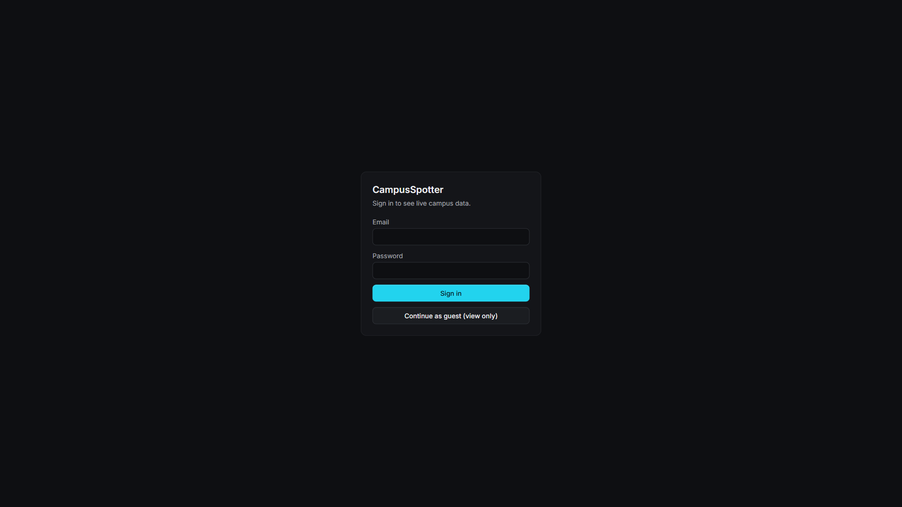
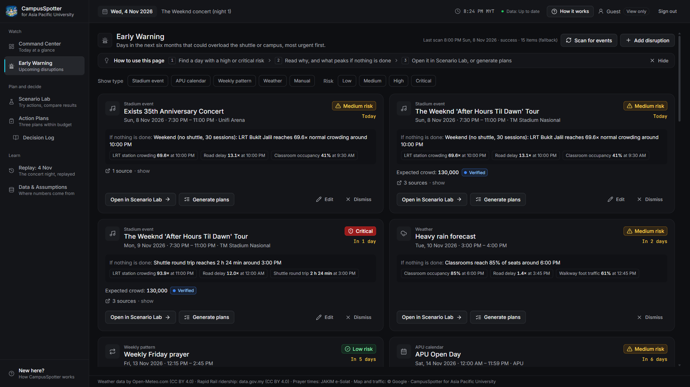
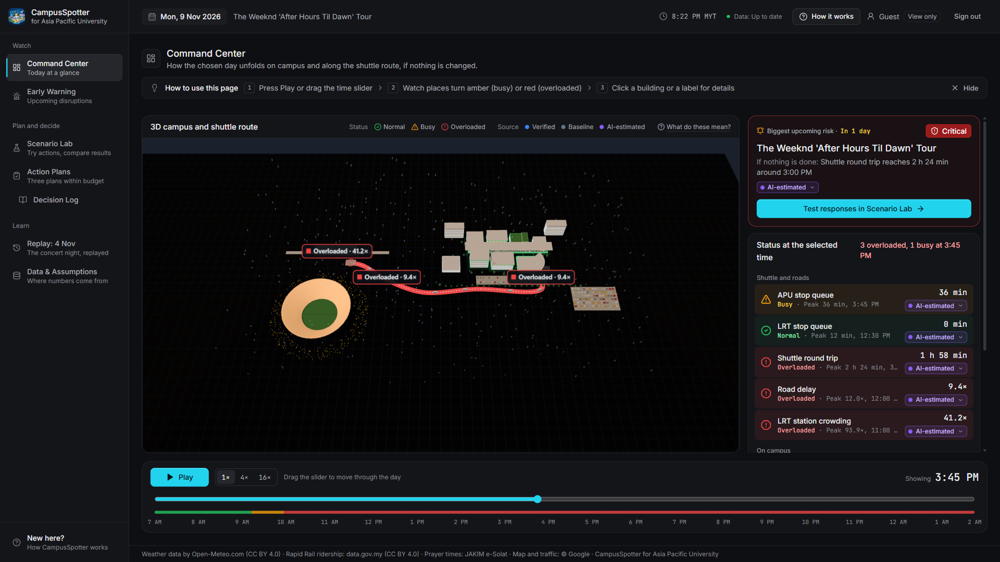
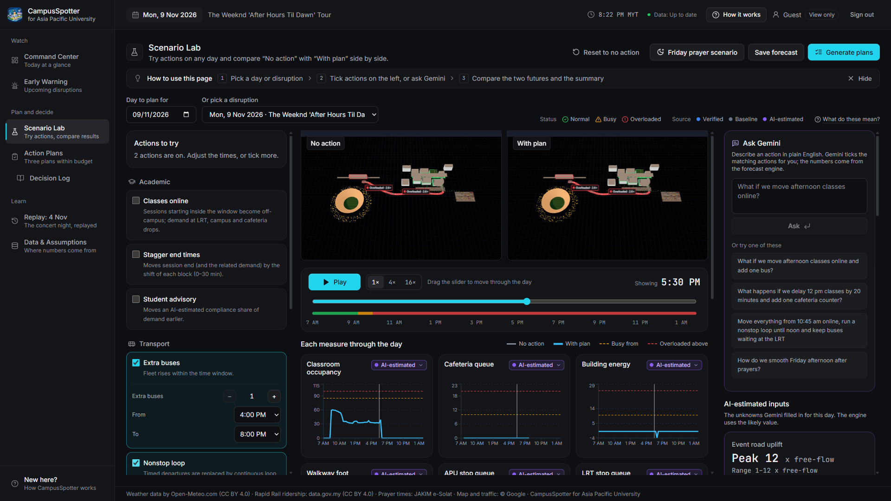
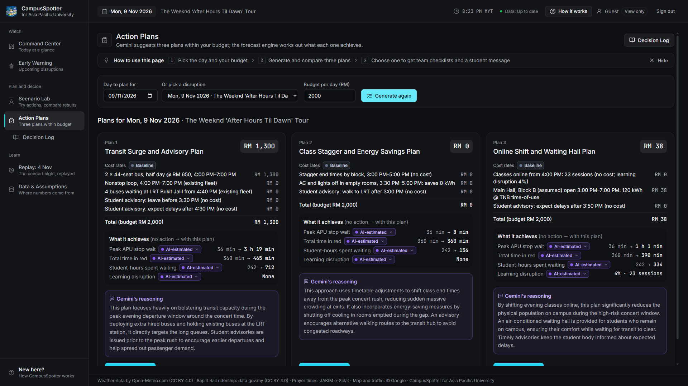
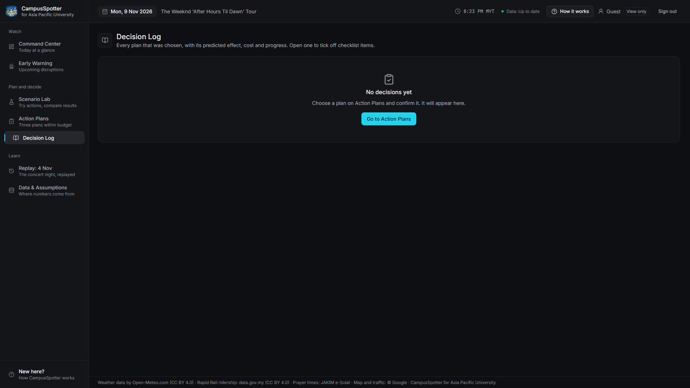
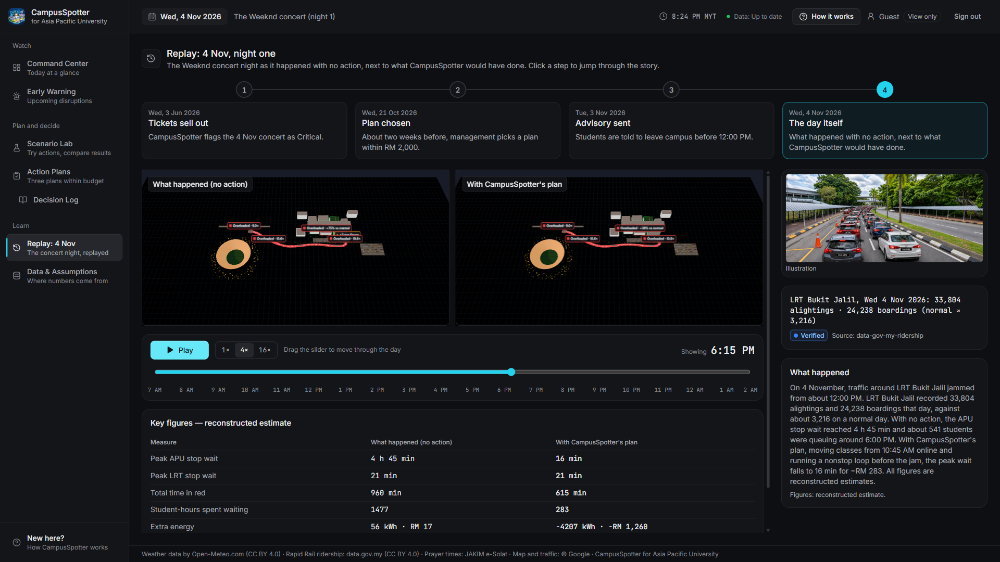
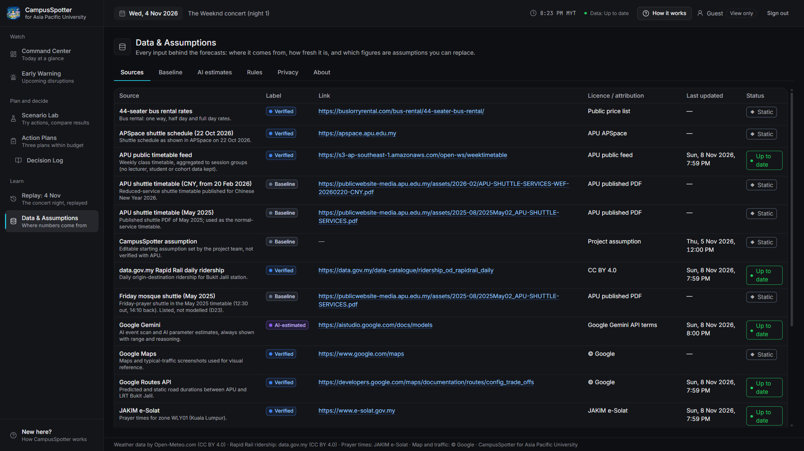
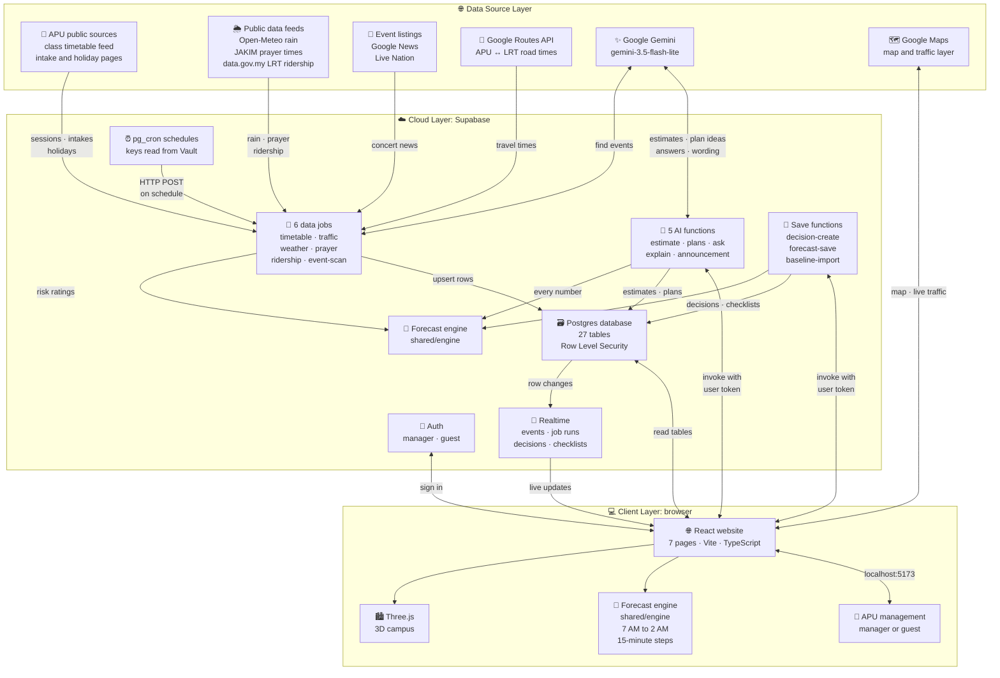

<p align="center">
  
</p>

<h1 align="center">CampusSpotter</h1>

<p align="center">
  <strong>See it coming, test the response, act early.</strong><br />
  An early-warning and action-planning website for Asia Pacific University (APU) management.
</p>

<p align="center">
  
  
  
  
  
</p>

<p align="center">
  
  
  
  
  
</p>

---

## Contents

1. [The problem](#1-the-problem)
2. [How CampusSpotter solves it](#2-how-campusspotter-solves-it)
3. [Product overview](#3-product-overview)
4. [System architecture](#4-system-architecture)
5. [Setup guide](#5-setup-guide)
   - [Part A: Install the tools](#part-a-install-the-tools-one-time)
   - [Part B: Get your Google API keys](#part-b-get-your-google-api-keys)
   - [Part C: Set up Supabase and start CampusSpotter](#part-c-set-up-supabase-and-start-campusspotter)
     - [Option 1: Supabase CLI (terminal)](#option-1-supabase-cli-terminal)
     - [Option 2: Supabase website](#option-2-supabase-website)
   - [Part D: Optional checks](#part-d-optional-checks)
6. [Troubleshooting](#6-troubleshooting)
7. [Project structure](#7-project-structure)
8. [Data sources and credits](#8-data-sources-and-credits)

---

## 1. The problem

CampusSpotter was built for the theme **Data-Driven Research & Intelligent Decision Making**:

> Data-driven solutions that help researchers and management analyse information, identify trends and predict outcomes. Use data analysis to uncover insights, identify trends, and support smarter decisions.

The theme suggests three kinds of solution:

- AI research intelligence and trend analysis
- Research data analysis and visualisation assistant
- Predictive research and resource planning

### The real problem at APU

APU sits near **TM Stadium Nasional** and **LRT Bukit Jalil**. Most students travel between the LRT station and campus on the APU shuttle bus.

On **4 and 5 November 2026**, The Weeknd performed at the stadium. Traffic around the campus was jammed from about 12:00 PM to 2:00 AM. Shuttles got stuck, queues at the bus stops grew, and students waited a long time.

The concerts sold out on **3 June 2026**, five months earlier. The warning was public. What was missing was a way to connect *"a big event is coming"* to *"this is what will happen to our campus, this is what we should do, and this is what it costs"*.

The same kind of problem happens with heavy rain, Friday prayer, new-student intake weeks and public holidays.

## 2. How CampusSpotter solves it

CampusSpotter follows the decision from the first warning to a finished plan, in one website.

| Hackathon use case | What CampusSpotter does |
| --- | --- |
| **AI research intelligence and trend analysis** | Every morning, **Early Warning** scans event listings and news with Google Gemini, and checks the weather forecast, prayer times, the APU timetable, intakes and holidays. Each upcoming day gets a risk rating: Low, Medium, High or Critical. |
| **Research data analysis and visualisation** | **Command Center** shows a 3D model of the campus that changes colour as you drag a time slider through the day. Nine measures are tracked, such as the queue at the APU bus stop, the cafeteria queue, classroom occupancy and building energy use. You can also ask questions in plain English in **Scenario Lab**. |
| **Predictive research and resource planning** | A forecast engine predicts each day from 7:00 AM to 2:00 AM in 15-minute steps. **Scenario Lab** lets you test actions (extra buses, online classes, staggered class times, opening a waiting hall, and more) and see the effect at once. **Action Plans** gives three ready-made plans within your budget, each with its cost in RM, a checklist for each team, and a draft message for students. |

### The four-step workflow

1. **Early Warning**: see which coming days could overload the shuttle or campus, and how risky each one is.
2. **Command Center**: see how a day will unfold, hour by hour, on the 3D campus.
3. **Scenario Lab**: try actions or ask a question, and compare "no action" with "with plan".
4. **Action Plans**: choose one of three plans within budget. Every decision is saved in the **Decision Log**.

Two more pages help you learn and check the work:

- **Replay: 4 Nov** replays the concert night with and without a plan.
- **Data & Assumptions** lists every data source, every assumption and every AI estimate, and lets you export them.

### Why you can trust the numbers

- **Calculation, not opinion.** A fixed set of formulas produces every number. The same inputs always give the same result.
- **AI is kept in its place.** Gemini only estimates a short list of unknowns (such as how many concert-goers will use the LRT), suggests plans and explains results. It never produces a final number.
- **Every number shows where it came from.** Each figure carries a label: **Verified** (public or official data), **Baseline** (an assumed APU figure you can replace) or **AI-estimated** (with its reasoning and a range).
- **Nothing is hidden.** Missing data says "not enough data" instead of showing a guess. Plans over budget are marked. Moving classes online always shows its cost to learning.

### Result on the concert night

In the 4 November replay (a reconstructed estimate):

- With no action, the day rates **Critical**, with about 400 students queuing at the APU bus stop around 6:00 PM.
- The CampusSpotter plan cuts the longest wait at the APU stop by **at least 70%**, for **RM 2,000 or less**.

### Built with

React, TypeScript and Vite for the website · Three.js for the 3D campus · Supabase for the database, sign-in and server functions · Google Gemini for AI · Google Maps and Routes for live traffic.

---

## 3. Product overview

These screenshots come from the working website, running on a local computer with live data on 8 November 2026, signed in as the view-only guest. They follow the order a manager uses the pages: watch, test, decide, then learn.

### Sign in

Managers sign in with their email and password. Anyone else can click **Continue as guest (view only)**.



### Early Warning

Upcoming days that could overload the shuttle or campus, most urgent first. Each card shows the risk rating, what peaks if nothing is done and where the event was found. From a card you can open the day in Scenario Lab or go straight to plans.



### Command Center

The 3D campus on Monday 9 November, a concert day, at 3:45 PM. Red labels mark overloaded places along the shuttle route. The panel on the right shows all nine measures at the chosen time, each with its source label. Press **Play** or drag the slider to move through the day.



### Scenario Lab

Two actions are switched on here: extra buses and a nonstop shuttle loop. The "No action" and "With plan" campuses play side by side, and the charts and day summary update at once. On the right you can ask Gemini a what-if question and see the unknowns it estimated for this day.



### Action Plans

Three plans from Gemini for the same concert day, within a budget of RM 2,000. Each plan lists its cost line by line, what it changes compared with no action, and Gemini's reasoning. Every number comes from the forecast engine, not from Gemini. Choosing a plan creates a checklist for each team and a draft message for students.



### Decision Log

Every chosen plan is saved here with its predicted effect, cost and checklist progress. This screenshot shows the log before any plan was chosen.



### Replay: 4 Nov

The concert night replayed. The left campus shows what happened with no action and the right one shows CampusSpotter's plan. The steps at the top tell the story from the ticket sell-out on 3 June to the night itself, and the table compares the key figures.



### Data & Assumptions

Every data source with its label (**Verified**, **Baseline** or **AI-estimated**), link, licence and when it was last updated. The other tabs list the baseline figures you can replace, the AI estimates, the thresholds, risk rules and cost rates, privacy notes and an About page.



---

## 4. System architecture

CampusSpotter has three layers. Public data and Google services feed in at the top. Supabase stores the data and runs the server functions in the middle. The website runs in your browser at the bottom.



### How the parts work together

- **Daily data jobs.** `pg_cron` calls six data jobs on a schedule (times in the [daily data schedule](#daily-data-schedule)). They fetch the class timetable, road travel times, weather, prayer times, LRT ridership and upcoming events, save them in the database, and update the risk rating of each upcoming day.
- **One forecast engine in two places.** The formulas in `shared/engine` run in the browser, so the 3D campus and Scenario Lab update at once. The same code runs in the server functions, so risk ratings and saved plans use exactly the same numbers.
- **Gemini suggests, the engine calculates.** Gemini finds events, estimates unknowns, proposes plans, answers questions and drafts messages. The engine works out every figure.
- **Live updates.** Supabase Realtime sends new events, job runs, decisions and checklist ticks to every open browser.
- **Access rules.** Every visitor signs in, as a manager or as the guest. Row Level Security lets any signed-in user read the data, and only the manager can edit events, sources and baseline figures.
- **Keys stay where they belong.** The browser holds only the publishable key and the map key. The Gemini and Routes keys are Edge Function secrets, and the secret key the scheduled jobs use is kept in Vault.

### Server functions

| Group | Functions | What they do |
| --- | --- | --- |
| Data jobs | `sync-timetable`, `sync-traffic`, `sync-weather`, `sync-prayer`, `sync-ridership`, `event-scan` | Fetch outside data on a schedule and save it. `event-scan` also runs when someone clicks **Scan for events** on Early Warning. |
| AI | `ai-estimate`, `ai-plans`, `ai-ask`, `ai-explain`, `ai-announcement` | Ask Gemini for estimates, three plans, what-if answers, explanations and the student message. |
| Saving | `decision-create`, `forecast-save`, `baseline-import` | Save a chosen plan with its checklists, save a forecast, and import replacement baseline figures. |
| Check | `engine-version` | Reports which version of the forecast engine the server runs. |

### Daily data schedule

| Job | What it fetches | Runs automatically (Malaysia time) |
| --- | --- | --- |
| `sync-timetable` | APU class timetable | Every day, 5:00 AM |
| `sync-traffic` | Road travel times from Google Routes | Every day, 5:30 AM |
| `event-scan` | Upcoming events and disruptions, found with Gemini | Every day, 6:00 AM |
| `sync-weather` | Weather forecast from Open-Meteo | Every 3 hours |
| `sync-prayer` | Prayer times from JAKIM e-Solat | Every Monday, 4:00 AM |
| `sync-ridership` | LRT passenger numbers from data.gov.my | Every day, 11:30 PM |

---

## 5. Setup guide

This guide assumes you have never set up a software project before. Follow the steps in order and copy commands exactly.

### What you need

- A Windows or Mac computer with an internet connection
- A Google account
- A free Supabase account (you create it in Part C)
- About 1 to 2 hours

### Words you will see

- **Terminal**: a window where you type commands instead of clicking. You type a command, press **Enter**, and it runs.
- **Command**: a line of text you type into the terminal. In this guide, commands are shown in grey boxes. Copy the whole line.
- **Folder**: the same as a directory. The project folder is the one that contains a file called `package.json`.
- **API key**: a long secret code that lets CampusSpotter use an online service. Treat it like a password.
- **Supabase**: a free online service that stores CampusSpotter's data, handles sign-in and runs its server programs.
- **CLI**: a tool you use by typing commands in the terminal. The **Supabase CLI** sets up Supabase from the terminal.
- **SQL**: the language used to give commands to a database. You paste SQL into the Supabase website if you choose Option 2 in Part C.

---

### Part A: Install the tools (one time)

#### Step A1: Install Node.js

Node.js is the engine that runs CampusSpotter on your computer.

1. Go to <https://nodejs.org>.
2. Click the download button marked **LTS** (it means "long-term support", the stable version). You need version **24 or newer**.
3. Open the downloaded file and click **Next** (or **Continue**) on every screen until it finishes. Keep all the default options.

#### Step A2: Install Visual Studio Code

Visual Studio Code (VS Code) is a free editor. You will use it to open the project, edit settings files and type commands.

1. Go to <https://code.visualstudio.com>.
2. Click **Download** for your system (Windows or Mac).
3. Open the downloaded file and follow the installer. On Windows, tick **Add to PATH** if you see it.

#### Step A3: Download the CampusSpotter code

1. Open the CampusSpotter page on GitHub: <https://github.com/ShawnLYZ/CampusSpotter>.
2. Click the green **Code** button, then **Download ZIP**.
3. Find the ZIP file in your **Downloads** folder and unzip it:
   - **Windows**: right-click the file, choose **Extract All**, then **Extract**.
   - **Mac**: double-click the file.
4. You now have a folder named `CampusSpotter` (or `CampusSpotter-main`). Move it somewhere easy to find, such as your **Documents** folder.

<details>
<summary>Already use Git? Clone instead.</summary>

```bash
git clone https://github.com/ShawnLYZ/CampusSpotter.git
```

</details>

#### Step A4: Open the folder in VS Code

1. Open VS Code.
2. Click **File** → **Open Folder…** (on Mac: **File** → **Open…**).
3. Select the `CampusSpotter` folder and click **Select Folder** (or **Open**). Choose the folder that directly contains `package.json`, not a folder above it.
4. If VS Code asks *"Do you trust the authors of the files in this folder?"*, click **Yes, I trust the authors**.

You should see a list of files on the left, including `package.json` and `README.md`.

#### Step A5: Open the terminal

In VS Code, click **Terminal** → **New Terminal** in the top menu. A panel opens at the bottom of the window. This is where you type commands. It is already pointed at the project folder.

Check that Node.js is installed. Type this and press **Enter**:

```bash
node --version
```

You should see something like `v24.16.0`. If you see *"not recognized"* or *"command not found"*, close VS Code completely, open it again, and retry. If it still fails, restart your computer.

#### Step A6: Download the project's building blocks

Type this and press **Enter**:

```bash
npm install
```

This downloads everything CampusSpotter needs. It takes one to three minutes. Yellow `WARN` lines are normal. When it finishes, you see the blinking cursor again.

> [!NOTE]
> On Windows, if you see *"running scripts is disabled on this system"*, see [Troubleshooting](#6-troubleshooting).

---

### Part B: Get your Google API keys

CampusSpotter uses three Google keys:

| Setting name | What it does |
| --- | --- |
| `VITE_GOOGLE_MAPS_KEY` | Shows the live map on the Command Center |
| `GEMINI_API_KEY` | Runs the AI features: event scanning, estimates, plans, explanations |
| `GOOGLE_ROUTES_KEY` | Fetches road travel times between APU and LRT Bukit Jalil every day |

There are three ways to get them. **Option 1** is the full, recommended setup. **Options 2 and 3** are free shortcuts for trying the project.

Paste each key into a blank note for now. You will put them into a settings file in Part C.

> [!WARNING]
> API keys work like passwords. Never post them in chat, email or screenshots. The settings files (`.env` and `.env.local`) are already set up so they are never uploaded to GitHub.

#### Option 1 (recommended): Google Cloud with your organisation's account

Use this if your organisation (for example, your university or company) has a Google Cloud account with billing, or if you have your own Google Cloud billing account. It gives you all three keys with higher limits.

**Step B1: Sign in**

1. Go to <https://console.cloud.google.com>.
2. Sign in with your work or organisation Google account (or a personal Google account).
3. If this is your first visit, choose your country, accept the terms and click **Agree and continue**.

**Step B2: Create a project**

A project is a folder in Google Cloud that holds your keys and settings.

1. At the top of the page, click the project picker (next to the Google Cloud logo).
2. Click **New Project**.
3. Project name: `CampusSpotter`.
4. **Organization** and **Location**: choose your organisation, if one is shown.
5. Click **Create**. Wait for the notification, then click **Select Project**.

**Step B3: Turn on billing**

Google needs a billing account for Maps, Routes and the paid tier of Gemini.

1. Click the menu **☰** (top left) → **Billing**.
2. Click **Link a billing account** and choose your organisation's billing account.
   - If you don't see one, or you don't have permission, ask your organisation's Google Cloud administrator to link it for you.
   - If you use a personal account, follow the prompts to create one. New accounts usually receive free trial credit.
3. Recommended: go to **Billing** → **Budgets & alerts** → **Create budget** and set a small monthly budget (for example RM 50) so Google emails you before costs grow.

**Step B4: Turn on the three Google services**

1. Click **☰** → **APIs & Services** → **Library**.
2. Search for each name below, click it, then click **Enable**:
   - **Gemini API** (it may be called **Generative Language API**)
   - **Maps JavaScript API**
   - **Routes API**

**Step B5: Create the map key (used in the browser)**

1. Click **☰** → **APIs & Services** → **Credentials**.
2. Click **+ Create credentials** → **API key**.
3. Give it a name: `CampusSpotter map`.
4. Under **Application restrictions**, choose **Websites**, click **Add**, and type:

   ```
   http://localhost:5173/*
   ```

5. Under **API restrictions**, choose **Restrict key** and tick only **Maps JavaScript API**.
6. Click **Create** (or **Save**). Click **Show key** and copy it. This is your `VITE_GOOGLE_MAPS_KEY`.

> If Google creates the key straight away without showing these options, click the key's name in the list to open its settings, set the restrictions above, and click **Save**.

**Step B6: Create the server key (used for AI and traffic)**

1. Back on **Credentials**, click **+ Create credentials** → **API key** again.
2. Name: `CampusSpotter server`.
3. **Application restrictions**: leave as **None**. This key is used by Supabase's servers, whose address changes.
4. **API restrictions**: choose **Restrict key** and tick **Gemini API** (or **Generative Language API**) and **Routes API**.
5. Click **Create** (or **Save**), then copy the key.

Use this one key for both `GEMINI_API_KEY` and `GOOGLE_ROUTES_KEY`.

> [!NOTE]
> **Why two keys?** The map key ends up inside the website, where anyone could read it. So it is locked to the map and to your own website address. The server key stays on Supabase's servers and is never sent to the browser.

> [!NOTE]
> Some organisations block API key creation. If **API key** is greyed out or you see a permission error, ask your Google Cloud administrator.

#### Option 2 (free): Gemini API key from Google AI Studio

A free Gemini key with no billing account.

1. Go to <https://aistudio.google.com> and sign in with a Google account.
2. Click **Get API key** (in the left menu or on the home page).
3. Click **Create API key**. If asked, choose **Create a new project** (or pick an existing one).
4. Copy the key. This is your `GEMINI_API_KEY`. You need only this one key: it runs every AI feature in CampusSpotter.

Things to know about the free key:

- It has a limit on how many AI requests you can make per minute and per day. When you reach it, the AI features show an error until the limit resets. The rest of the website keeps working.
- Google may use what you send on the free tier to improve its products, so don't use it with private data.

#### Option 3 (free): Google Maps Demo Key

A free Maps key with no credit card, made for testing. (The name "Demo Key" is Google's; it is a normal key for the live website.)

1. Make sure you are signed in to a **personal** Google account (such as a `@gmail.com` address). Work and school (Google Workspace) accounts are not eligible.
2. Go to <https://mapsplatform.google.com/maps-demo-key/>.
3. Click **Get demo key** and accept the terms.
4. Your key appears on screen and is also emailed to you. Copy it. This is your `VITE_GOOGLE_MAPS_KEY`.

Things to know about the Maps Demo Key:

- There is a daily usage limit. When you reach it, the map pauses until the next day. You are never charged.
- It supports only some Maps features. The map, place markers and the bus route line work. Some extras, such as the live traffic colours, may not appear.
- It also supports the Routes API's route calculation, so you can try it as your `GOOGLE_ROUTES_KEY`. If the daily traffic job fails with it, use a key from Option 1 instead.
- It is meant for testing, not for long-term use.

---

### Part C: Set up Supabase and start CampusSpotter

Supabase stores CampusSpotter's data, handles sign-in, runs the AI and data programs on its servers, and refreshes the data every day on its own.

Steps C1 to C3 and Step C11 are the same for everyone. For Steps C4 to C10 you choose one of two ways: **Option 1** uses the Supabase CLI in the terminal, and **Option 2** uses the Supabase website. See [Choose how to set up Supabase](#choose-how-to-set-up-supabase).

Before you start, have these ready:

- [ ] The tools from Part A installed, and `npm install` finished
- [ ] A Gemini key and a Google Routes key (Part B, Option 1 or 2)
- [ ] A Google Maps key (Part B, Option 1 or 3)

#### Step C1: Create a Supabase project

1. Go to <https://supabase.com> and click **Start your project**. Sign up with GitHub or with your email.
2. Click **New project**.
3. Fill in:
   - **Name**: `CampusSpotter`
   - **Database Password**: click **Generate a password**, then **copy it and save it somewhere safe** (for example a password manager). Option 1 (the CLI) needs it later, and Supabase will not show it again.
   - **Region**: **Southeast Asia (Singapore)**, the closest to Malaysia.
4. Click **Create new project**. Wait one or two minutes until the project is ready.

#### Step C2: Collect five details from Supabase

Add these to your note with the Google keys.

1. **Project ID**: click **Project Settings** (the gear icon, bottom left) → **General**. Copy the **Project ID**. It is a string of about 20 lowercase letters, such as `abcdefghijklmnopqrst`. It also appears in your browser's address bar: `supabase.com/dashboard/project/<Project ID>`.
2. **Project URL**: this is `https://` + your Project ID + `.supabase.co`, for example `https://abcdefghijklmnopqrst.supabase.co`.
3. **Publishable key** and 4. **secret key**: go to **Project Settings** → **API Keys** and open the **Publishable and secret API keys** tab. If the tab is empty, click **Create new API keys**.
   - Copy the **publishable** key. It starts with `sb_publishable_`.
   - Under **Secret keys**, click the eye icon (**Reveal**) next to the key named `default`, then copy it. It starts with `sb_secret_`. Keep it private: it has full access to your database.
5. **Personal access token** (Option 1 only): go to <https://supabase.com/dashboard/account/tokens>. Click **Generate new token**, name it `CampusSpotter`, click **Generate token**, and copy it straight away (it is shown only once).

You also have the **database password** from Step C1 (Option 1 only).

> [!IMPORTANT]
> Don't use the keys on the **Legacy anon, service_role API keys** tab. They start with `eyJ`, Supabase is removing them, and CampusSpotter refuses them.

#### Step C3: Create your settings files

CampusSpotter reads its keys and passwords from two private files in the project folder: `.env` (you fill it in) and `.env.local` (filled in during Step C9).

1. In the VS Code terminal, type:

   ```bash
   cp .env.example .env
   ```

   This copies the template into a new file called `.env`.
2. Click `.env` in the file list on the left to open it.
3. Fill in each line after the `=` sign. No spaces around `=`, and no quotation marks.

| Line | What to type |
| --- | --- |
| `VITE_SUPABASE_URL` | Your **Project URL** (C2, item 2) |
| `VITE_SUPABASE_PUBLISHABLE_KEY` | Your **publishable key** (C2, item 3) |
| `VITE_GOOGLE_MAPS_KEY` | Your **map key** (Part B) |
| `VITE_DEMO_EMAIL` | Leave empty. The view-only guest account's details go in `.env.local` in Step C9 |
| `VITE_DEMO_PASSWORD` | Leave empty, as above |
| `MANAGER_EMAIL` | **Your own email address.** You sign in with it. This one is required |
| `MANAGER_PASSWORD` | Option 1: leave empty to get a strong random password, or type your own (at least 12 characters). Option 2: leave empty, because you choose the password on the website |
| `SUPABASE_ACCESS_TOKEN` | Your **personal access token** (C2, item 5). Leave empty for Option 2 |
| `SUPABASE_DB_PASSWORD` | Your **database password** (C1). Leave empty for Option 2 |
| `SUPABASE_SECRET_KEY` | Your **secret key** (C2, item 4) |
| `GEMINI_API_KEY` | Your **Gemini key** (Part B). One key runs every AI feature |
| `GOOGLE_ROUTES_KEY` | Your **server key** or **Routes key** (Part B) |

A finished line looks like this:

```
VITE_SUPABASE_URL=https://abcdefghijklmnopqrst.supabase.co
```

4. Save with **Ctrl + S** (Mac: **Cmd + S**).
5. Create the second file: hover over the file list on the left and click the **New File** icon (a page with a +). Name it exactly `.env.local` (it starts with a dot), press **Enter**, and save it empty with **Ctrl + S**.

#### Choose how to set up Supabase

Steps C4 to C10 build the database, give Supabase your Google keys, upload the server functions and create the sign-in accounts. You can do them in two ways. Both give the same result.

| | Option 1: Supabase CLI | Option 2: Supabase website |
| --- | --- | --- |
| **How it works** | You copy commands into the VS Code terminal. Scripts do most of the work. | You click through the Supabase dashboard and paste SQL into its SQL Editor. |
| **Best for** | The quickest setup, and setting up again later | Seeing each change on screen, or when a script fails on your computer |
| **Terminal commands** | About 15 | 2, to upload the server functions (Step C8) |
| **Uses the access token and database password** | Yes | No |

Follow **one** option from Step C4 to Step C10, then continue at [Step C11](#step-c11-start-campusspotter).

> [!IMPORTANT]
> Build the database (Step C4) with one option only. The CLI keeps a record of which database files it has run, but the website does not. So if you built the database on the website, `npx supabase db push` later tries to create the tables again and fails.

#### Option 1: Supabase CLI (terminal)

You run every step in the VS Code terminal. The commands use the Supabase CLI (downloaded for you by `npx`) and CampusSpotter's setup scripts in the `scripts` folder.

##### Step C4 (CLI): Build the database

These commands use the Supabase tool. The first time, it asks *"Need to install the following packages… Ok to proceed?"*. Type `y` and press **Enter**.

1. Sign the Supabase tool in to your account:

   ```bash
   npx supabase login
   ```

   Press **Enter** when asked. A browser page opens: sign in and approve. If the terminal asks for a verification code, copy it from the browser page and paste it into the terminal.

2. Connect this folder to your project. Replace `YOUR_PROJECT_ID` with your Project ID:

   ```bash
   npx supabase link --project-ref YOUR_PROJECT_ID
   ```

   When asked for the database password, paste it and press **Enter**. The password stays invisible while you type. That is normal. You should see `Finished supabase link.`

3. Create the database tables:

   ```bash
   npx supabase db push
   ```

   It lists 6 files and asks *"Do you want to push these migrations?"*. Type `y` and press **Enter**. You may see a warning that mentions Docker. You can ignore it. The step worked if it ends with `Finished supabase db push.`

##### Step C5 (CLI): Load the starting data

```bash
npm run db:seed
```

This fills the database with campus data: rooms, shuttle timetables, cafeteria counters, the November concerts and more.

##### Step C6 (CLI): Set up the daily jobs

CampusSpotter refreshes its data automatically every day. This command stores the secret key and the project address those jobs need, inside your database's secure vault:

```bash
node --env-file=.env scripts/set-vault-secret.ts
```

You should see `ok`.

##### Step C7 (CLI): Give your Google keys to Supabase

The AI and traffic features run on Supabase's servers, so the servers need your keys. Type this command, replacing the two placeholders with your keys (no spaces, no quotation marks):

```bash
npx supabase secrets set GEMINI_API_KEY=your-gemini-key GOOGLE_ROUTES_KEY=your-routes-key
```

You should see `Finished supabase secrets set.`

> [!TIP]
> Prefer not to type keys into the terminal? Add them on the Supabase website instead, as in [Step C7 (website)](#step-c7-website-give-your-google-keys-to-supabase).

##### Step C8 (CLI): Upload the server functions

```bash
npx supabase functions deploy --use-api
```

This uploads 15 small programs (AI, saving decisions, daily data jobs) to Supabase. It takes a few minutes.

##### Step C9 (CLI): Create the sign-in accounts

First turn off public sign-up, so only the accounts you create can sign in:

```bash
node --env-file=.env scripts/auth-config.ts
```

You should see `auth config: ok`. Then create your manager account and a view-only guest account:

```bash
node --env-file=.env --env-file=.env.local scripts/create-accounts.ts
```

You should see `manager: ok`, `demo: ok` and `.env.local updated`. Open `.env.local`: your sign-in password is on the `MANAGER_PASSWORD` line (unless you chose your own).

##### Step C10 (CLI): Fetch today's data

The daily jobs run on their own (see the [daily data schedule](#daily-data-schedule)), but you can run them now so the website has fresh data straight away. Run each line one at a time and wait for it to finish:

```bash
node --env-file=.env scripts/run-job.ts sync-timetable
node --env-file=.env scripts/run-job.ts sync-weather
node --env-file=.env scripts/run-job.ts sync-prayer
node --env-file=.env scripts/run-job.ts sync-ridership
node --env-file=.env scripts/run-job.ts sync-traffic
node --env-file=.env scripts/run-job.ts event-scan
```

Each line should print the job name followed by `200`.

That's Option 1 done. Go to [Step C11](#step-c11-start-campusspotter).

#### Option 2: Supabase website

You do almost everything in the Supabase dashboard (<https://supabase.com/dashboard>). The only exception is Step C8, which needs two terminal commands.

**How to run SQL in Supabase.** Several steps below ask you to run SQL (commands for the database). Each time:

1. In the Supabase dashboard, open your project and click **SQL Editor** in the left menu.
2. Start a new, empty query (click **+** or **New query**).
3. Paste the SQL and click **Run** (or press **Ctrl + Enter**; Mac: **Cmd + Enter**).
4. The results panel at the bottom should say **Success**.

If Supabase shows a warning before it runs, for example about a *destructive operation*, click **Run this query**. The files are written for a new project.

##### Step C4 (website): Build the database

The database tables are described in six files in the `supabase/migrations` folder. Run them one at a time, **in this order**:

1. `20261105000001_extensions.sql`
2. `20261105000002_core_tables.sql`
3. `20261105000003_rls.sql`
4. `20261105000004_realtime.sql`
5. `20261105000005_cron.sql`
6. `20261108000001_cron_new_api_keys.sql`

For each file:

1. In VS Code, open the file from the `supabase/migrations` folder.
2. Click inside the file, press **Ctrl + A** (Mac: **Cmd + A**) to select everything, then **Ctrl + C** (Mac: **Cmd + C**) to copy it.
3. In the SQL Editor, start a new query, paste with **Ctrl + V** (Mac: **Cmd + V**) and click **Run**.
4. Wait for **Success** before you move on to the next file.

To check: click **Table Editor** in the left menu. You should see tables such as `profiles`, `rooms` and `disruptions`.

##### Step C5 (website): Load the starting data

1. In VS Code, open `supabase/seed/phase2-seed.sql`. It is a long file.
2. Copy everything in it (**Ctrl + A**, then **Ctrl + C**).
3. Paste it into a new query in the SQL Editor and click **Run**.

This fills the database with campus data: rooms, shuttle timetables, cafeteria counters, the November concerts and more. To check, open **Table Editor** and click `rooms`: it should list the campus rooms.

##### Step C6 (website): Set up the daily jobs

CampusSpotter refreshes its data automatically every day. The daily jobs need two details, kept in your database's secure vault: your Project URL and your secret key.

Copy this SQL into a new query, replace the two values (keep the single quotes `'` around them) and click **Run**:

```sql
select vault.create_secret('https://abcdefghijklmnopqrst.supabase.co', 'project_url');
select vault.create_secret('sb_secret_paste-your-secret-key-here', 'secret_key');
```

- First value: your **Project URL** (Step C2, item 2), with no `/` at the end.
- Second value: your **secret key** (Step C2, item 4).

If you see `duplicate key value violates unique constraint`, the secrets are already saved. See [Troubleshooting](#6-troubleshooting) to replace them.

##### Step C7 (website): Give your Google keys to Supabase

The AI and traffic features run on Supabase's servers, so the servers need your keys.

1. In the Supabase dashboard, click **Edge Functions** in the left menu, then **Secrets**.
2. Add two secrets:
   - Name `GEMINI_API_KEY`, value: your Gemini key
   - Name `GOOGLE_ROUTES_KEY`, value: your Routes key
3. Click **Save**.

##### Step C8 (website): Upload the server functions

This is the one step that needs the terminal. The function editor on the Supabase website can't upload CampusSpotter's functions, because they share code kept in other folders of the project.

The first time, the Supabase tool asks *"Need to install the following packages… Ok to proceed?"*. Type `y` and press **Enter**.

1. Sign the Supabase tool in to your account:

   ```bash
   npx supabase login
   ```

   Press **Enter** when asked. A browser page opens: sign in and approve. If the terminal asks for a verification code, copy it from the browser page and paste it into the terminal.

2. Upload the functions. Replace `YOUR_PROJECT_ID` with your Project ID (Step C2, item 1):

   ```bash
   npx supabase functions deploy --use-api --project-ref YOUR_PROJECT_ID
   ```

   This uploads 15 small programs (AI, saving decisions, daily data jobs). It takes a few minutes.

To check: open **Edge Functions** in the dashboard. You should see 15 functions, such as `ai-plans` and `sync-weather`.

##### Step C9 (website): Create the sign-in accounts

**Turn off public sign-up**, so only the accounts you create can sign in:

1. Click **Authentication** in the left menu, then **Sign In / Providers**.
2. Turn off **Allow new users to sign up**, then click **Save changes**.
3. Still under **Authentication**, click **URL Configuration**. Set **Site URL** to `http://localhost:5173` and click **Save changes**. Under **Redirect URLs**, click **Add URL**, type `http://localhost:5173/**` and save it.

**Create your manager account and a view-only guest account:**

4. Click **Authentication** → **Users** → **Add user** → **Create new user**.
5. Fill in:
   - **Email**: your own email address (the one on the `MANAGER_EMAIL` line in `.env`)
   - **Password**: at least 12 characters. Add it to your note.
   - Tick **Auto Confirm User**.
6. Click **Create user**.
7. Repeat steps 4 to 6 for the guest account, with the email `demo@campusspotter.app` and a different password. The guest password is built into the website (it powers the **Continue as guest** button), so don't reuse a password from anywhere else.

**Make your account the manager.** New accounts start as view-only. Run this SQL, with your email in place of `you@example.com`:

```sql
update public.profiles set role = 'manager', display_name = 'APU Manager'
where id = (select id from auth.users where email = lower('you@example.com'));

update public.profiles set role = 'demo', display_name = 'Guest'
where id = (select id from auth.users where email = 'demo@campusspotter.app');

select u.email, p.role from public.profiles p join auth.users u on u.id = p.id;
```

The result should list two rows: your email with `manager`, and `demo@campusspotter.app` with `demo`.

**Save the sign-in details for the website.** Open `.env.local` in VS Code, add these four lines with your own details, and save:

```
VITE_DEMO_EMAIL=demo@campusspotter.app
VITE_DEMO_PASSWORD=the-guest-password
MANAGER_EMAIL=you@example.com
MANAGER_PASSWORD=your-manager-password
```

The website reads the first two lines for the **Continue as guest** button. The checks in Part D use the other two.

##### Step C10 (website): Fetch today's data

The daily jobs run on their own (see the [daily data schedule](#daily-data-schedule)), but you can run them now so the website has fresh data straight away.

1. Run this SQL. It starts five of the jobs, the same way the daily schedule does:

   ```sql
   select job, net.http_post(
     url := (select decrypted_secret from vault.decrypted_secrets where name = 'project_url') || '/functions/v1/' || job,
     headers := jsonb_build_object('Content-Type', 'application/json',
       'apikey', (select decrypted_secret from vault.decrypted_secrets where name = 'secret_key')),
     body := '{}'::jsonb,
     timeout_milliseconds := 120000) as request_id
   from unnest(array['sync-timetable', 'sync-weather', 'sync-prayer', 'sync-ridership', 'sync-traffic']) as job;
   ```

2. Wait one minute. Then replace the last line with the line below and click **Run** again. The event scan goes last so its risk ratings use the fresh data.

   ```sql
   from unnest(array['event-scan']) as job;
   ```

3. Wait about two minutes, then check the results in a new query:

   ```sql
   select id, status_code, left(content, 150) as reply, error_msg
   from net._http_response
   order by id desc
   limit 6;
   ```

   Each row should show `200` under `status_code`. If a row has no status yet, that job is still running: wait a minute and run the check again.

That's Option 2 done. Go to [Step C11](#step-c11-start-campusspotter).

#### Step C11: Start CampusSpotter

1. In the terminal, type:

   ```bash
   npm run dev
   ```

   After a few seconds you will see:

   ```
     VITE ready in 900 ms
     ➜  Local:   http://localhost:5173/
   ```

2. Hold **Ctrl** (Mac: **Cmd**) and click the `http://localhost:5173/` link, or type `localhost:5173` into Chrome, Edge or Safari.
3. On the sign-in page:
   - sign in with your `MANAGER_EMAIL` and `MANAGER_PASSWORD` (from `.env.local`) for full access, or
   - click **Continue as guest (view only)**.
4. Click **How it works** at the top for a short tour.

> [!NOTE]
> The website only runs while the terminal is open. `localhost` means "this computer", so nobody else can see it.

**To stop** the website, click inside the terminal and press **Ctrl + C**. **To start it again** later, open the folder in VS Code, open a terminal (**Terminal** → **New Terminal**) and run `npm run dev`. You only need to do Parts A to C once.

> [!TIP]
> The website reads `.env` and `.env.local` only when it starts. After you change a setting, stop it with **Ctrl + C** and run `npm run dev` again.

---

### Part D: Optional checks

These are for developers who want to confirm everything works.

| Command | What it checks |
| --- | --- |
| `npm test` | Runs the automated tests |
| `npm run typecheck` | Checks the code for type errors |
| `npm run build` | Builds the finished website into the `dist` folder |
| `npm run check:secrets` | Builds the website and confirms no server secret ended up in it |
| `node --env-file=.env --env-file=.env.local scripts/smoke-functions.ts` | Calls every server function as the guest user, then removes what it created |

---

## 6. Troubleshooting

**"running scripts is disabled on this system" (Windows)**
Windows blocks `npm` in PowerShell by default. In the terminal, run this once, type `Y` and press **Enter**:

```powershell
Set-ExecutionPolicy -Scope CurrentUser RemoteSigned
```

Then close the terminal (trash-can icon) and open a new one.

**"node is not recognized" or "command not found: node"**
Node.js is not installed, or VS Code was open while you installed it. Close VS Code completely and open it again. If that doesn't help, restart your computer.

**"Port 5173 is in use"**
CampusSpotter is already running in another terminal. Find that terminal and press **Ctrl + C**, or just use the copy that is already running.

**The page says "VITE_SUPABASE_URL is not set." or "VITE_SUPABASE_PUBLISHABLE_KEY is not set."**
Fill in that line in `.env` (Step C3), save, and restart `npm run dev`. If your `.env` came from an older copy of CampusSpotter, it may have a `VITE_SUPABASE_ANON_KEY` line instead. Rename it to `VITE_SUPABASE_PUBLISHABLE_KEY` and put your publishable key after the `=`.

**The page or a script says a key "holds a legacy anon or service_role key"**
That key starts with `eyJ`, so it is one of Supabase's old keys, which CampusSpotter no longer accepts. Copy the publishable or secret key from the **Publishable and secret API keys** tab instead (Step C2, items 3 and 4). For scripts, also rename an old `SUPABASE_SERVICE_ROLE_KEY` line in `.env` to `SUPABASE_SECRET_KEY`.

**The page says "VITE_SUPABASE_PUBLISHABLE_KEY holds a secret key"**
You put the secret key (`sb_secret_…`) on the website's line. Put the publishable key (`sb_publishable_…`) there instead. The secret key belongs only on the `SUPABASE_SECRET_KEY` line.

**A script says "VITE_SUPABASE_URL must look like https://&lt;project-id&gt;.supabase.co"**
Check the `VITE_SUPABASE_URL` line in `.env`. It should be exactly `https://` + your Project ID + `.supabase.co`.

**A script says "MANAGER_EMAIL is not set"**
Put your own email address on the `MANAGER_EMAIL` line in `.env`, save, and run the command again.

**A script says `401`, `403` or "is not set"**
Check the matching line in `.env`. Make sure your personal access token and keys were copied in full, with no spaces.

**The map says "Live map is off"**
The map key is missing. Check that the line starts with exactly `VITE_GOOGLE_MAPS_KEY=`, that you saved the file, and that you restarted `npm run dev`.

**The map is grey or says "For development purposes only"**
In Google Cloud, check that **Maps JavaScript API** is enabled, that billing is linked, and that the key's website restriction is exactly `http://localhost:5173/*`.

**"Guest access isn't configured" on the sign-in page**
Run Step C9 (either option) and check that `.env.local` has the `VITE_DEMO_EMAIL` and `VITE_DEMO_PASSWORD` lines filled in. Then restart `npm run dev`.

**The SQL Editor or `npx supabase db push` says something "already exists"**
That database file has already run, and it worked the first time. In the SQL Editor, move on to the next file. If `db push` says it, you built the database on the website (Option 2), so skip `db push`.

**Step C6 (website) says "duplicate key value violates unique constraint"**
The two vault secrets are already saved. To replace them, run this instead, with your own values:

```sql
select vault.update_secret((select id from vault.secrets where name = 'project_url'), 'https://abcdefghijklmnopqrst.supabase.co');
select vault.update_secret((select id from vault.secrets where name = 'secret_key'), 'sb_secret_paste-your-secret-key-here');
```

**Step C10 (website) shows `401` or `404`**
`404` means the server functions aren't uploaded yet: do Step C8. `401` means the secret key in the vault is wrong: replace it as in the entry above, with the key from Step C2, item 4.

**Sign-in says "Email not confirmed"**
The account was created on the website without **Auto Confirm User**. In **Authentication** → **Users**, delete the account, add it again with the box ticked, then run the manager SQL in Step C9 (website) again.

**I signed in with my own email but the top bar says "View only"**
Your account isn't the manager yet. Run the manager SQL in Step C9 (website) with the exact email you sign in with, then reload the page.

**AI features say the limit was reached (error 429)**
Your free Gemini key reached its limit. Wait for it to reset (usually by the next day), or use a key from Google Cloud (Part B, Option 1).

**My settings file is called `.env.txt`**
Some editors add `.txt` on their own. Create and edit settings files in VS Code, and make sure the name is exactly `.env` or `.env.local`.

---

## 7. Project structure

```
CampusSpotter/
├── src/                  The website: pages, 3D campus, charts
├── shared/
│   ├── engine/           The forecast formulas (the same code runs in the browser and on the server)
│   ├── parsers/          Readers for timetables, prayer times, weather, news and other sources
│   └── fixtures/         Saved campus data, used to fill a new database and by the tests
├── supabase/
│   ├── migrations/       Database tables, access rules and daily schedules
│   ├── functions/        Server functions: AI, saving decisions, daily data jobs
│   └── seed/             Starting data for a new database
├── scripts/              Setup helpers used in Part C
├── tests/                Tests that run against a live Supabase project
├── public/               Images and icons
├── screenshots/          Website screenshots used in this README
├── .env.example          Template for your settings file
└── package.json          Project name, commands and the list of building blocks
```

---

## 8. Data sources and credits

| Data | Source | Licence |
| --- | --- | --- |
| Weather | [Open-Meteo](https://open-meteo.com) | CC BY 4.0 |
| Prayer times | JAKIM e-Solat | JAKIM e-Solat |
| LRT ridership | [data.gov.my](https://data.gov.my) Rapid Rail daily ridership | CC BY 4.0 |
| Road travel times | Google Routes API | © Google |
| Map | Google Maps | © Google |
| Road routing | OSRM, using OpenStreetMap data | ODbL |
| Class timetable, shuttle schedules | APU public timetable feed and published shuttle timetables | APU public sources |
| Electricity tariff | TNB tariff (from 1 July 2025) | Public tariff |
| AI estimates and event extraction | Google Gemini | Google Gemini API terms |

**Disclaimer:** CampusSpotter is an independent hackathon project. It is not affiliated with or endorsed by Asia Pacific University. Figures such as student population and shuttle fleet size are assumptions. They are labelled **Baseline** in the app and can be replaced on the **Data & Assumptions** page. The 4 November replay is a reconstructed estimate, and the traffic image on the Replay page is an illustration.
